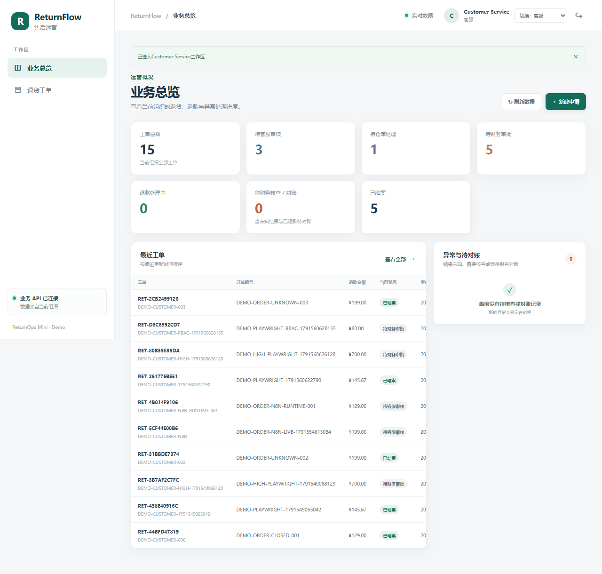

# ReturnFlow — Returns and Refunds Workflow Demo

[中文说明](README.md) | English

ReturnFlow is a self-contained, multi-tenant returns and refunds workflow demonstration for small e-commerce teams. Customer service, warehouse and finance roles coordinate requests, inspection, approval, payment intent and reconciliation. The ReturnOps API owns business facts and the refund state machine. n8n handles authenticated intake and read-only digests; it does not approve or issue refunds.

## Workflow and responsibilities

- Customer service creates and reviews a return case.
- Warehouse records receipt and inspection.
- Finance authorizes a refund; high-value refunds require two distinct finance approvers for the same amount.
- An outbox worker sends a stable idempotent intent to the local Fake Payment provider.
- Provider evidence is reconciled before a refund is marked successful; closure is a separate decision.

A timeout after the payment provider processes an intent is **unknown**, not proof of failure. The worker must not blindly retry a possibly effected refund. Provider query or webhook evidence is required for reconciliation. A provider success response alone does not prove all business obligations are completed.

## Demo and architecture

[Chinese demo video](docs/assets/returnflow-demo.mp4) · [Subtitles](docs/assets/returnflow-demo.zh-CN.srt) · [Recorded walkthrough](docs/RECORDING.en.md)

- **Backend:** FastAPI, PostgreSQL, SQLAlchemy/Alembic, optimistic concurrency, transactional outbox and worker.
- **Frontend:** React, TypeScript, Vite and Playwright.
- **Automation:** n8n intake and a scheduled operations digest delivered to local Mailpit.
- **Payment:** a local fake provider with deterministic failure modes, idempotency and authoritative query paths.
- **Deployment:** isolated Docker Compose demo using loopback-bound ports and synthetic users, cases and payment data.

The browser role selector is explicitly a demo identity switch, **not production authentication**. The fake provider and Mailpit do not process real payments or deliver external email. The repository does not claim production readiness or adoption.

## Start and verify

On Windows with PowerShell 7 and Docker Desktop running Linux containers:

    .\scripts\start-demo.ps1
    .\scripts\verify-demo.ps1

The start script provisions the isolated Compose stack, databases, synthetic seed data, local n8n owner, credentials and workflows. Local secrets live in ignored files; exported workflow JSON does not contain credentials.

To check the Python code and applicable tests:

    .\scripts\verify.ps1

PostgreSQL concurrency tests require a configured RETURNOPS_TEST_DATABASE_URL and the integration flag. For frontend tests:

    cd frontend
    npm ci
    npm run build
    npm run lint
    npm run e2e:typecheck
    npm run test:e2e

Actual n8n runtime/browser integration checks are separate from the ordinary lightweight checks; consult [test evidence](docs/TEST-EVIDENCE.en.md) for the tested versions, scenarios, results and limitations.

To exercise the provider-ACK-loss scenario:

    .\scripts\run-unknown-demo.ps1

Stop without deleting persistent data:

    .\scripts\stop-demo.ps1

An intentional reset needs separate confirmation:

    .\scripts\reset-demo.ps1

## Workflow boundaries and evidence

- Current tenant and role permissions are enforced by the server, not merely by frontend visibility.
- Requests use scoped idempotency keys and database uniqueness constraints.
- A high-value initial approval changes the version even if the business status stays unchanged, preventing duplicate first approvers.
- External side effects, provider acknowledgements, observed payment evidence, reconciliation and case closure are distinct.
- Failure injection and tests verify the declared paths only; successful checks are not universal guarantees.
- Scheduled n8n and real network behaviors are evidenced only for the specified local environment and observed run windows.

## Documentation

- [Architecture and security boundary](docs/ARCHITECTURE.en.md)
- [Business invariants](docs/invariants.en.md)
- [Failure scenarios and acceptance expectations](docs/failure-lab.en.md)
- [Demo operation](docs/DEMO.en.md)
- [Test evidence and limitations](docs/TEST-EVIDENCE.en.md)
- [Portfolio case](docs/PORTFOLIO.en.md)
- [Project presentation](docs/INTERVIEW-PITCH.en.md)
- [n8n integration](n8n/README.en.md)
- [Fault injection harness](faultlab/README.en.md)
- [Initial implementation baseline (historical)](docs/BASELINE.en.md)
- [Contributing](CONTRIBUTING.en.md)

This README describes the **current demonstration**. Historical measurements and initial baselines remain labeled by their original evidence conditions; they are not automatically current production claims.
