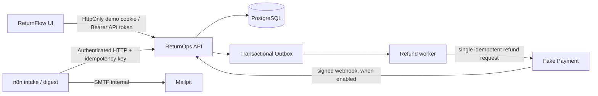

# ReturnFlow architecture and security boundaries

## Components



The default Compose ports are Frontend `4173`, API `8000`, Fake Payment `8090`, n8n `5678`, and Mailpit Web `8025`; all bind to `127.0.0.1`. Services use the Compose network names `api`, `payment`, and `mailpit` rather than the host loopback address.

## Business facts are owned by the API

```text
REQUESTED ──support──> AUTHORIZED ──warehouse──> RECEIVED ──inspection──> INSPECTED
    │                                                                    │
    └──support rejection──> REJECTED                                     └──finance approval──> REFUND_PENDING
                                                                                  │
                                             REFUND_UNKNOWN <──timeout──┤        │
                          finance queries Fake Payment ─────────────────┘        └──success──> REFUNDED
                                                                                              │
                                                                            finance reconciliation──> RECONCILED ──> CLOSED
```

High-value refunds require four-eyes approval according to `RETURNOPS_HIGH_VALUE_THRESHOLD`: the first approval leaves an independent record while the case remains `INSPECTED`; the second approval must come from a different user for the same amount, and only then is the refund intent created. The server-side state machine, roles, tenant, and version checks are the final gate; the frontend's `allowedActions` only hides actions the current identity cannot perform.

## Idempotency and refund reliability

- Writes and audit events commit in the same database transaction; the refund intent and the `refund.dispatch` Outbox event are created together in the approval transaction.
- The Worker first claims Outbox events with a lease, then dispatches with a stable provider idempotency key. A timeout is not treated as a failure and resent; local state enters `REFUND_UNKNOWN`, and the dispatch count does not increase because of automatic retries.
- Both synchronous provider responses and webhooks can confirm payment facts. Updates are idempotently deduplicated by refund intent, provider reference, and evidence.
- For unknown outcomes, first query Fake Payment by idempotency key: if it succeeded, fill in authoritative evidence and move to `REFUNDED`; only when confirmed absent is a controlled recovery action offered. Finance then performs reconciliation and closing separately.
- Fake Payment's simulation mode is determined by backend configuration or a restricted one-off demo command; ReturnFlow's customer API accepts no parameter that can specify arbitrary failures.

## Identity, organization, and data

- Every request resolves `organization_id` and roles from effective membership; all queries, idempotency keys, events, refund intents, and audit rows are scoped to the organization.
- The browser uses a short-lived server-created HttpOnly cookie by default; when the user explicitly switches to API Token mode, the client holds the token only in current memory. The frontend never writes long-lived bearer tokens to `localStorage` or `sessionStorage`.
- Demo accounts and samples use `example.test` email addresses, synthetic order numbers, and customer reference numbers. `seed-demo.ps1` is repeatable and does not print raw service tokens; automation credentials are stored in ignored `.local/` files.
- n8n calls only the ReturnOps HTTP API. Workflow JSON contains no bearer token, organization secret, database node, or Fake Payment write node. Digest email is delivered to Mailpit through internal SMTP.
- The `/v1/overview` `attentionItems` map current case states to support, warehouse, or finance and give the next action; state counts, exceptions, and cases awaiting reconciliation all come from the current organization's PostgreSQL records. A successfully refunded `REFUNDED` case that has not been reconciled remains in the finance exception/reconciliation center until it reaches `RECONCILED`.

## n8n initialization and runtime boundaries

1. A human only needs to run `scripts/start-demo.ps1`; it handles Compose, seed, owner initialization, local credential generation, workflow upsert, binding, and publishing. On first use, if the Playwright toolchain is missing, it installs dependencies and Chromium from the lockfile.
2. Automation scripts use a 90-day n8n bootstrap API key stored only in Git-ignored `.local/` to manage local credentials/workflows through the n8n public REST API; the key is never written into workflow JSON. If it expires or a step fails midway, rerunning verifies and restores the current state without deleting volumes.
3. ReturnOps workflow credentials reference only a permission-limited automation user; that user can create cases and read to-dos, but cannot approve refunds, trigger payments, or reconcile. Webhook Basic Auth and Mailpit SMTP credentials are likewise stored only in the local n8n encrypted data volume.
4. The Daily Schedule Trigger uses Compose's `GENERIC_TIMEZONE` (default `Asia/Shanghai`); both manual Digest and one real 09:00 scheduled Digest have been verified through Mailpit. All services bind only to loopback; Fake Payment and Mailpit never reach real payments or send external email.

For current local n8n 2.42.5 runtime evidence, clean-environment auto-start reproduction, and boundary records, see [`TEST-EVIDENCE.en.md`](TEST-EVIDENCE.en.md).
